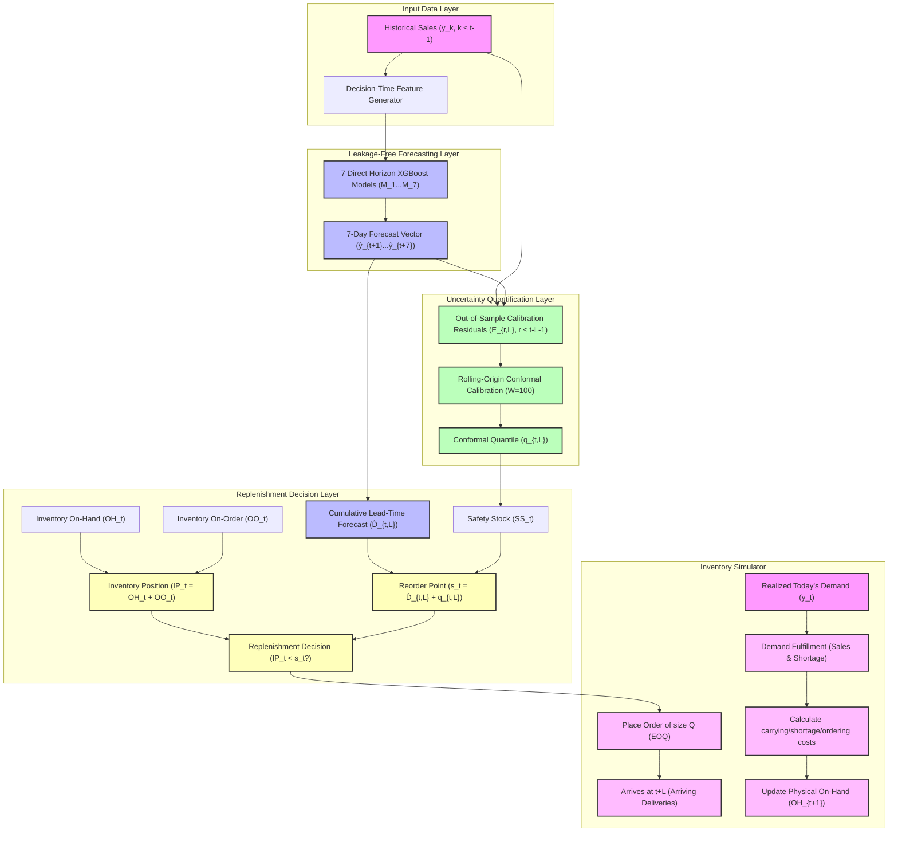

# Journal Extension Architecture

This document maps out the system components, data flows, and chronological dependencies of the journal extension's leakage-free uncertainty-aware inventory replenishment framework, highlighting the isolation of the original conference baseline.

---

## 1. System Architecture Flow

The flowchart below traces the path of information from historical demand observations through point-forecasting, conformal calibration, and rolling inventory simulation.



---

## 2. Chronological Pipeline Isolation

To preserve scientific integrity, the conference pipeline and the new journal pipelines are completely decoupled:

### **Original Conference Pipeline (Frozen)**
```
Raw Data → Lag/Rolling Feature Engine (Shift-1) → Single Global XGBoost → Pre-computed Point Forecasts
```
* **Status**: Locked. No parameters, models, or data inputs are modified.

### **Journal Extension Pipeline (Proposed)**
```
Raw Data → Direct Multi-Horizon Feature Engine (Shift-h) → 7 Decoupled XGBoost Models (M_1...M_7) 
         → Real-Time Point Forecast Vector (ŷ_{t+1}...ŷ_{t+L})
         → Rolling Conformal Quantiles (q_{t,L}, r ≤ t-L-1)
         → Inventory Position s_t
         → Daily (s, Q) Replenishment Simulator
```
* **Status**: Methodology audit completed. No data leakage or temporal indexing errors permitted.
